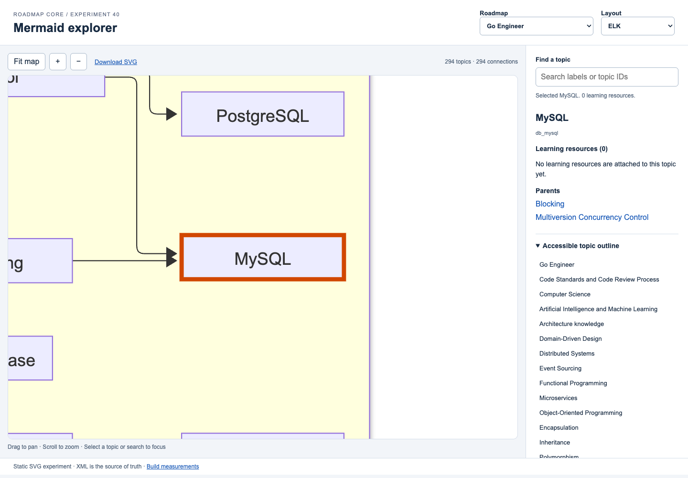

# Mermaid HTML prototype — issue #40

Independent experiment for [#40](https://github.com/dzyanis/roadmap/issues/40),
using the shared validated XML pipeline from #47. Includes DSA, expanded OS,
full Go and full DevOps. No production renderer or deployment change.

Read the [comparison matrix and proposed decision](COMPARISON.md).
Both layouts and Graphviz are selectable in the demo.

## Run the committed demonstration

No renderer installation is needed to preview the committed files. From repository root:

```sh
python3 -m http.server 8000 --bind 127.0.0.1
```

Open <http://127.0.0.1:8000/docs/prototypes/mermaid/demo/>.
Example topic link:
<http://127.0.0.1:8000/docs/prototypes/mermaid/demo/#roadmap=go&layout=elk&topic=db_mysql>.
Use HTTP, not `file://`, because the viewer fetches SVG and JSON.

Choose a roadmap/layout, drag to pan, scroll or use +/− to zoom, and Fit map to
return to the overview. Search labels/IDs and press Enter or select a result.
Click a topic to inspect all resources and parents/children. Resources open a new
tab so the map keeps its position. With the map focused, arrows pan and Home fits.
Mobile supports one-finger pan and zoom buttons; pinch zoom is not implemented.

## Rebuild and verify

Requirements: Python 3.9+, xmllint, Graphviz (`dot`), Node **26.13.0** for browser
tooling. Measured Graphviz: **16.1.1**. CI uses Ubuntu's Graphviz and Python 3.13,
so it confirms behavior rather than pixel-identical macOS output.

```sh
npm ci --prefix docs/prototypes/mermaid
python3 docs/prototypes/mermaid/build.py
npm test --prefix docs/prototypes/mermaid
```

Lockfile: Mermaid CLI **12.2.0**, Mermaid **12.3.0** (override), Puppeteer **25.17.0**.
`npm ci` installs pinned Chrome for Testing. Measurements used system Chrome
**157.0.8103.51** via `PUPPETEER_EXECUTABLE_PATH`. Set `MMDC` to another installation
of the same CLI version if needed. Configuration is in `dagre.json`/`elk.json`:
LR, default theme, Arial, explicit wrapping, 25-unit node spacing, 45-unit rank
spacing, linear edges, SVG text and deterministic IDs. Loose mode enables topic
links only in escaped repository-generated input; this is not an arbitrary-source
rendering service. CI passes `puppeteer-ci.json` in an isolated runner.

```sh
make check
make test
```

`build.py --output /tmp/mermaid-demo` writes an isolated directory. Inputs resolve
relative to the checkout, not the working directory. The demo includes source
files, Graphviz baseline, all topic/resource data and [metrics](demo/metrics.json).
The browser test uses the default `demo/` folder and hosts it under
`/roadmap/docs/prototypes/mermaid/demo/` to test project-relative URLs. It writes
[browser results](browser-results.json), screenshots and bounded PNGs (max
6000 px high, 3000 px wide). The demo needs no CDN or renderer runtime.

The prototype workflow rebuilds and checks affected PRs (also manual dispatch),
then uploads a runnable demo/evidence artifact. It does not publish GitHub Pages.
The existing workflow still runs all repository tests.

## Previews



[Full-map overview](previews/overview.png) · [Mobile screenshot](previews/mobile.png)

| Input | Dagre SVG | ELK SVG | Graphviz SVG | Bounded ELK PNG |
| --- | --- | --- | --- | --- |
| dsa | [SVG](demo/dsa-dagre.svg) | [SVG](demo/dsa-elk.svg) | [SVG](demo/dsa-graphviz.svg) | [PNG](previews/dsa-elk.png) |
| os | [SVG](demo/os-dagre.svg) | [SVG](demo/os-elk.svg) | [SVG](demo/os-graphviz.svg) | [PNG](previews/os-elk.png) |
| go | [SVG](demo/go-dagre.svg) | [SVG](demo/go-elk.svg) | [SVG](demo/go-graphviz.svg) | [PNG](previews/go-elk.png) |
| devops | [SVG](demo/devops-dagre.svg) | [SVG](demo/devops-elk.svg) | [SVG](demo/devops-graphviz.svg) | [PNG](previews/devops-elk.png) |

One SVG anchor is preserved per topic. Only renderer syntax uses aliases; JSON
retains original IDs, labels, typed edges, subjects, resources and translations.
Tests compare committed sources/data against current XML and check every SVG
anchor. Both incoming MySQL connections are retained. Public SVG link targets are
normalized to `data-topic`; renderer DOM class names are not topic identifiers.

The viewer supplies navigation, highlighting, resources and accessible HTML;
the renderer supplies layout, grouping, text and links. SVGs are trusted build
artifacts, not an upload surface. The two branches duplicate the small viewer
intentionally to remain independent; production should extract it once after the
decision. Branch collapse is assessed in the comparison, not implemented.

Keyboard and emulated mobile interactions pass. Screen readers, Safari/Firefox,
actual mobile devices and pinch zoom remain unverified. See the comparison for
limitations, licensing, previous findings and proposed production scope.
